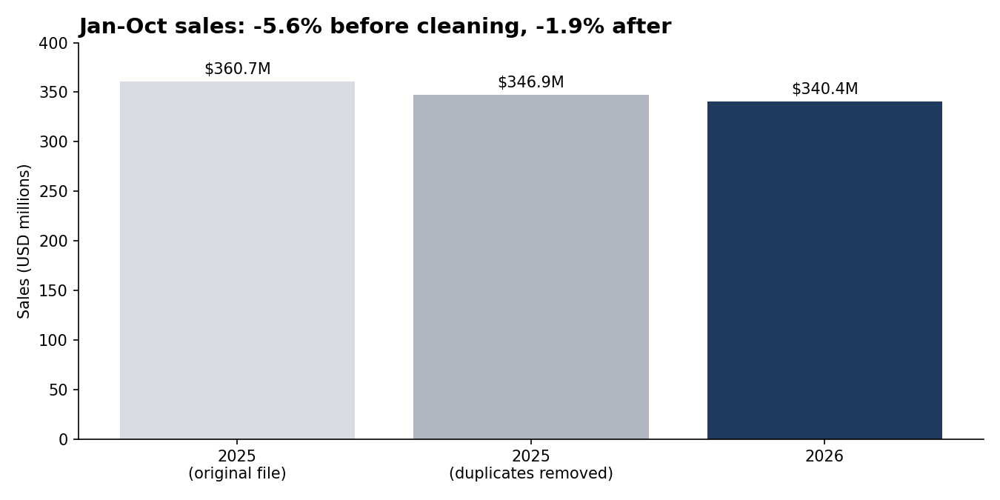
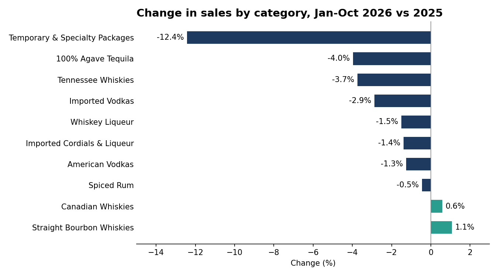
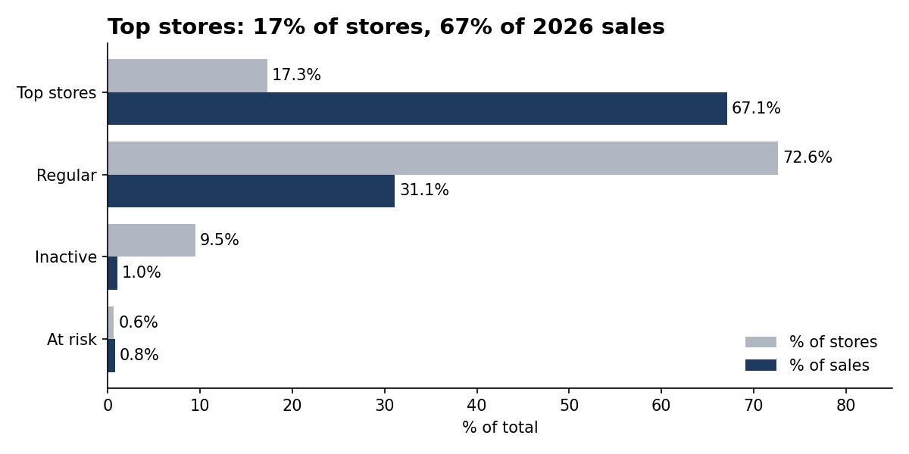

# Iowa Liquor Sales: 2025 vs 2026 (Python)

I analysed about 4 million rows of Iowa liquor sales with Python to find out if sales really fell in 2026, and which stores a distributor should focus on.

## Context
**Who asks:** the sales manager at a spirits distributor in Iowa.

**Question:** Did sales really fall in 2026, and which stores should the sales team focus on?

**Tools:** Python (pandas, matplotlib) in Jupyter Notebook.

## Summary
**Sales are almost flat, not falling.** At first, 2026 looked 5.6% below 2025. Most of that gap came from 77,452 duplicated rows in the 2025 file. With them removed, sales from January to October fell by only 1.9% (USD 340.4M compared with USD 346.9M).

**Focus on the top stores and call the ones at risk.** 386 stores (17%) bring in 67% of 2026 sales, and 14 stores that used to buy well have not ordered in over a month.

## Data source
- Source: Iowa Liquor Sales [2026](https://catalog.data.gov/dataset/iowa-liquor-sales-2026) and [2025](https://catalog.data.gov/dataset/iowa-liquor-sales-2025), published by the Alcohol Operations Bureau, State of Iowa, on data.gov (CC BY 4.0).
- Each row is one product within an invoice: a licensed store buying spirits from the state.
- The 2026 data runs from 1 January to 30 October 2026, so I compared it with the same period of 2025: 2,029,764 rows for 2026 and 2,116,267 for 2025 (2,038,815 after removing duplicates).

## Approach
1. **Loading:** joined the files of each year with `pd.concat` and checked the dates.
2. **Total and monthly sales:** compared January to October in both years, then month by month.
3. **The October spike:** daily sales in late October 2025 were about double the usual level. I found no news or official source to explain it, so I checked the data for duplicates.
4. **Cleaning:** removed the duplicated rows and matched two categories that were renamed during 2025, then repeated the analysis.
5. **Categories:** compared the top 10 categories by sales.
6. **Customer segmentation (RFM):** scored every store in 2026 by recency (last order), frequency (number of orders) and monetary value (sales), and grouped them into segments.

## Main findings
**Data quality**
1. The 2025 file had 77,452 duplicated rows, almost all from 20 October onwards. Every column was identical, including the invoice number, so the same purchases were counted twice. They added USD 13.8M to 2025 sales.
2. Without them, the October spike disappears. October is the best month in both years: USD 38.5M in 2025 and USD 39.0M in 2026.
3. Two categories changed name during 2025 ("Liqueurs" to "Liqueur", "Spirits Specialty" to "Spirit Specialty"). I matched them by category code, so they don't show as false drops or rises.

**Sales**
4. From January to October, sales fell by 1.9% in 2026, about USD 6.5M less. The largest monthly gaps were January (-8.2%) and April (-5.1%).
5. Most of the top 10 categories changed only slightly, between -4% and +1%. The clear exception is Temporary & Specialty Packages (gift sets and limited-time packs), down 12.4%, about USD 1.3M.

**Stores**
6. 386 stores, 17% of all 2,237 stores, bring in 67% of 2026 sales (USD 228.5M).
7. 14 stores are at risk: they used to spend well but have not ordered in over a month. The largest, Madella Wine and Spirits in Bettendorf, bought USD 674.8K this year but has not ordered since 13 July.

## Recommended actions
1. **Report sales as stable, not in decline.** The -5.6% was mostly a data problem.
2. **Protect the top 386 stores.** They are two thirds of the business.
3. **Call the 14 stores at risk,** starting with the largest, to find out why they stopped ordering.
4. **Look at Temporary & Specialty Packages** before the Christmas season, since it is the category that fell the most.

## Data limitations
- These are purchases by stores from the state, not sales to final consumers.
- The cause of the duplicated rows is unknown. I removed only rows that were identical in every column.
- The number of distinct invoices is very different between the two files, so I counted orders only within 2026 (for the RFM), never year on year.
- The RFM score ranges and segment rules are my own business choices.

## Repository contents
- `iowa_liquor_sales.ipynb`: the full analysis
- `sales_before_after.png`, `category_change.png`, `store_segments.png`: charts
- The data files are not included because of their size. They can be downloaded from the links above.

## Contact
**Catalina Gonzalez**

  
  
  

